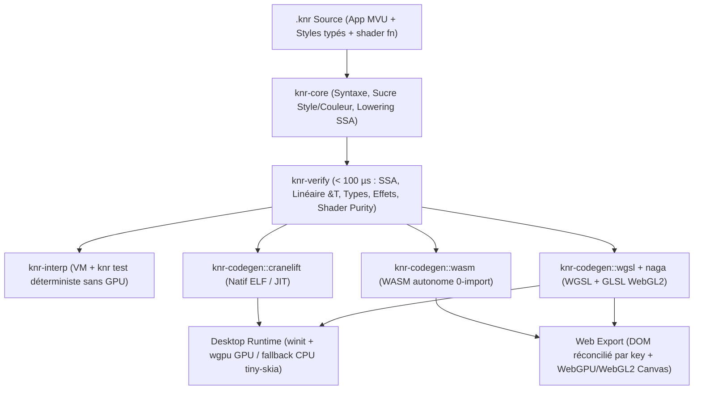
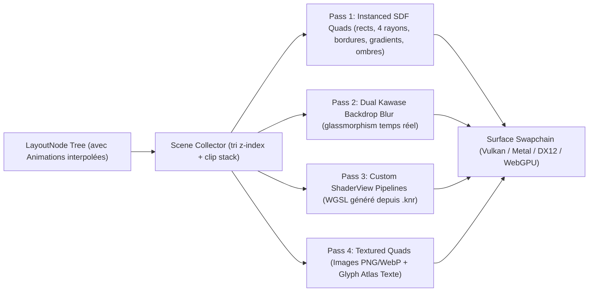

# Plan Directeur — UI Sans Contraintes, Animations 120 FPS & Shaders GPU Natifs en `.knr`

> **Objectif** : Permettre de **tout concevoir, styliser, animer et rendre en GPU (y compris des shaders)** directement dans le langage `.knr` — sans jamais écrire une seule ligne de HTML, CSS, JavaScript ou GLSL à la main — tout en gardant **un seul code source** pour Desktop natif (Vulkan/Metal/DX12), Web (DOM + WebGPU/WebGL2 + WASM), et CI headless déterministe.

---

## 1. Vision Architecturale Globale



### Atouts déjà disponibles dans le dépôt & le cache local
- **Backend GPU & validation shaders déjà présents** : `wgpu 23.0.1`, `naga 23.1.0`, `bytemuck 1.25.2`, `image 0.25.10`, `kurbo 0.13.1`, `accesskit 0.17.1`, `winit 0.30.13`, `tiny-skia 0.11.4`, `ab_glyph 0.2.32`.
- **Modèle mémoire linéaire Zero-GC** : aucune pause Garbage Collector pendant une frame à 16,6 ms (60 FPS) ou 8,3 ms (120 FPS).
- **SSA pure & statiquement typée** : une fonction `shader fn` en `.knr` se traduit quasiment 1:1 en WGSL (WebGPU/Vulkan/Metal/DX12) et en GLSL (WebGL2) via `naga`.

---

## 2. Stylisation Totale Sans Contraintes Directement en `.knr`

Le but est d'éliminer **toute frustration** liée à un modèle de style trop rigide (les 11 champs actuels de `UiNode`), tout en gardant **zéro CSS brut**, **zéro cascade/conflit `!important`**, et une **vérification statique O(1)**.

### 2.1 Ergonomie dans le langage `.knr` (`knr-core/src/syntax/`)
Pour que styliser un composant soit aussi agréable (et plus sûr pour les humains comme pour les IA) que Tailwind/SwiftUI/Flutter :
1. **Littéraux couleur typés natifs** : `#0f172a` (RGB) et `#38bdf880` (RGBA) abaissés en struct `Color { r: f64, g: f64, b: f64, a: f64 }`, plus fonctions `rgba(...)`, `hsla(...)`, `mix_color(a, b, t)`.
2. **Valeurs par défaut & *Struct Spread* (`..base`)** :
   ```knr
   let card_style = Style {
       bg: Fill::LinearGradient(135.0, #0f172a, #1e1b4b),
       radius: Corners::all(16.0),
       pad: Edges::xy(28.0, 24.0),
       border: Border::solid(1.0, #38bdf840),
       shadow: Shadow { x: 0.0, y: 12.0, blur: 32.0, spread: 0.0, color: #00000080 },
       backdrop_blur: 14.0,
       ..Style::default()
   };
   ```
   -> Plus besoin de répéter 15 champs à chaque widget, et les thèmes (`Theme`) se composent par simple héritage de valeur (`..theme.card`) sans aucune magie globale.
3. **Tableaux & chaînes fluides** : littéraux `[a, b, c]` inférés automatiquement dans `vec[UiNode]`, évitant les suites verbeuses de `vec_push`.

### 2.2 Modèle de Style Complet (`std/ui.knr` + `knr-runtime/src/gui/style_v2.rs`)
Chaque nœud UI porte un `Style` typé couvrant **100 % des besoins modernes** :

| Catégorie | Types & Champs typés en `.knr` | Rendu Desktop (`wgpu`) | Rendu Web (`--target web`) |
| :--- | :--- | :--- | :--- |
| **Dimensions** | `w`, `h`, `min_w`, `max_w`, `min_h`, `max_h` de type `Size` (`Auto`, `Px(f64)`, `Pct(f64)`, `Fill`, `Fr(f64)`) | Solver Flexbox + Grid | `width/height/min-*/max-*` |
| **Layout** | `display` (`Flex`, `Grid`, `Stack`), `dir` (`Row`, `Col`, `RowRev`, `ColRev`), `wrap`, `justify`, `align`, `align_self`, `grow`, `shrink`, `gap_x`, `gap_y`, `grid_cols`, `grid_rows` | Moteur layout 2-passes (Flexbox + Grid) | `display: flex / grid` natif |
| **Espacement & Position** | `pad: Edges(t, r, b, l)`, `margin: Edges`, `pos: Position` (`Relative`, `Absolute(t, r, b, l)`), `z_index: i64`, `overflow: Overflow` (`Visible`, `Hidden`, `ScrollY`, `ScrollX`, `ScrollBoth`) | Scissor GPU + offsets scroll | `padding`, `margin`, `position`, `z-index`, `overflow` |
| **Peinture & Fond** | `bg: Fill` (`None`, `Solid(Color)`, `LinearGradient(deg, stops)`, `RadialGradient(cx, cy, stops)`, `Image(src, Fit)`, `Shader(name, uniforms)`) | SDF Quad Shader GPU | `background`, ``, `<canvas>` WebGPU |
| **Bordures & Coins** | `border: Border` (uniforme ou par côté `t/r/b/l`, épaisseur + couleur), `radius: Corners(tl, tr, br, bl)` | SDF 4 rayons exacts anti-aliasés | `border`, `border-radius` |
| **Ombres & Verre** | `shadow: Shadow` (`x, y, blur, spread, color, inset`), `backdrop_blur: f64`, `opacity: f64`, `blend: BlendMode` (`Normal`, `Multiply`, `Screen`, `Add`) | Ombre SDF analytique + Dual Kawase Blur GPU | `box-shadow`, `backdrop-filter: blur()`, `opacity`, `mix-blend-mode` |
| **Typographie** | `font_family: str`, `font_size: f64`, `font_weight: i64`, `italic: bool`, `color: Color`, `line_height: f64`, `letter_spacing: f64`, `text_align`, `text_wrap`, `ellipsis: bool` | Atlas de glyphes `ab_glyph` multi-graisses | Propriétés CSS typo exactes |
| **Transforms 2D/3D** | `translate_x`, `translate_y`, `scale_x`, `scale_y`, `rotate_deg`, `skew_x`, `skew_y`, `origin_x`, `origin_y`, `perspective` | Matrice `Mat4` dans le vertex shader | `transform` + `transform-origin` |
| **États & Transitions** | `hover: StylePatch`, `active: StylePatch`, `focus: StylePatch`, `cursor: Cursor`, `transition: Transition(ms, Easing)` | Interpolation GPU fluide par `key` | `:hover/:active/:focus` + `transition` |

### 2.3 Catalogue Complet des Widgets (`UiKind`)
- **Conteneurs** : `Box`, `Row`, `Col`, `Grid`, `Stack` (superposition type `ZStack`), `ScrollView`.
- **Contenu** : `Text` (multiline + wrapping), `RichText` (spans colorés), `Image` (PNG/JPG/WebP via `image`), `SvgPath` (courbes vectorielles `kurbo`), `Canvas2D` (commandes vectorielles libres), `ShaderView` (surface GPU 2D/3D).
- **Contrôles interactifs** : `Button`, `TextInput` (saisie clavier, focus, curseur clignotant, Backspace/flèches/Copier-Coller, placeholder), `Slider` (glisser souris), `Toggle` / `Checkbox`.

---

## 3. Palier 1 — Boucle Temps Réel 60/120 FPS, Maths & Animations

### 3.1 Intrinsics Mathématiques & Vecteurs dans le Langage
Ajout de nouveaux opcodes dans `knr-core` (AST, parseur, formateur, `.knrbin` v1 compatible), `knr-verify`, `knr-interp`, `knr-codegen::cranelift`, `knr-codegen::wasm` et `knr-codegen::wgsl` :
- **Opcodes math `f64`** : `sin`, `cos`, `tan`, `atan2`, `sqrt`, `pow`, `abs`, `floor`, `ceil`, `min`, `max`, `clamp`, `lerp`, `smoothstep`, `mix`, `i64_to_f64`, `f64_to_i64`.
- **Types géométriques standard (`std/math.knr`)** : `Vec2`, `Vec3`, `Vec4`, `Color`, `Mat4` + opérateurs utilitaires (`dot`, `length`, `normalize`, `cross`, `reflect`).
- **Parité absolue** : même résultat dans la VM (`knr test`), en natif Cranelift, en WASM et en WGSL GPU.

### 3.2 Modèle MVU Réactif + Temps Réel
Extension rétro-compatible du contrat MVU :
```knr
fn init() -> State
fn update(state: State, action: str) -> State                  // Actions simples (déjà supporté)
fn on_event(state: State, ev: UiEvent) -> State                // Optionnel : souris, clavier, scroll, resize, text input
fn tick(state: State, dt: f64, elapsed: f64) -> State          // Optionnel : appelé à 60/120 FPS
fn view(state: &State) -> UiNode
```
- **Gestion intelligente du CPU** :
  - Si `tick` est absent **et** aucune `Transition` implicite n'est en cours -> mode événementiel (`ControlFlow::Wait`, **0 % CPU au repos**).
  - Dès que `tick` est défini **ou** qu'une transition/animation spring est active -> VSync 60/120 FPS (`winit` redraw continu / Web `requestAnimationFrame`).
- **Animations implicites par `key`** (`key: str` sur `UiNode`) : interpolation automatique (`Linear`, `EaseOutCubic`, `EaseInOutQuart`, `Spring { stiffness, damping }`).
- **Librairie d'animation explicite (`std/anim.knr`)** : `spring_step`, `ease_out_back`, `ease_in_out_cubic`, `ping_pong`, `stagger`.

### 3.3 Réconciliation DOM & Événements Web
- Remplacement du `root.replaceChildren(...)` par un **diffing léger par `key` (~150 lignes JS)** dans `crates/knr-cli/src/commands/build.rs` : préserve le focus clavier des `TextInput`, la position de scroll des `ScrollView`, et déclenche nativement les transitions CSS fluides.

---

## 4. Palier 2 — Moteur GPU Unifié (`wgpu`) & Shaders Natifs `.knr` -> WGSL

### 4.1 Architecture du Renderer GPU (`crates/knr-runtime/src/gui/gpu/`)
Backend `wgpu 23.0` pur Rust avec **fallback automatique transparent** vers `tiny-skia` CPU en environnement headless / CI sans GPU :



1. **`sdf_quad.wgsl`** : `InstanceBuffer` unique, SDF analytique 4 rayons, anti-aliasing `fwidth`, dégradés linéaires/radiaux, bordures et ombres douces.
2. **`blur.wgsl`** : Dual Kawase Blur GPU pour `backdrop_blur > 0.0`.
3. **`glyph_atlas.rs`** : cache LRU de glyphes `ab_glyph` sur texture GPU `R8Unorm` (2048×2048).
4. **`image_cache.rs`** : décodage PNG/JPEG/WebP (`image` crate) mis en cache GPU.
5. **`shader_pipeline.rs`** : pipelines WGSL par `shader fn` avec `UniformBuffer` (`resolution`, `time`, `dt`, `mouse`, + uniforms custom `.knr`).

### 4.2 Le 3e Backend Compilateur : `.knr` -> WGSL (`knr-codegen/src/wgsl/`)
```knr
shader fn neon_plasma(uv: Vec2, time: f64, intensity: f64) -> Color {
    let x = uv.x * 6.0;
    let y = uv.y * 6.0;
    let v1 = sin(x + time);
    let v2 = cos(y - time * 1.3);
    let v3 = sin((x + y + time * 0.7) * 0.5);
    let m = (v1 + v2 + v3) / 3.0 * 0.5 + 0.5;
    let r = clamp(m * intensity, 0.0, 1.0);
    let g = clamp((1.0 - m) * 0.8, 0.0, 1.0);
    let b = 0.95;
    return Color { r: r, g: g, b: b, a: 1.0 };
}
```
1. **Parseur & AST (`knr-core`)** : mot-clé `shader fn` -> flag `Function::is_shader: bool` (`.ssa` + `.knrbin`).
2. **Vérification GPU (`knr-verify/src/shader.rs`)** : zéro effet, zéro allocation heap, zéro récursion, vérification stricte de signature.
3. **Codegen WGSL (`knr-codegen/src/wgsl/mod.rs`)** : abaisse SSA vers WGSL + validation statique immédiate via **`naga`** dès `knr check`.
4. **Parité Web universelle** : WGSL (WebGPU) + GLSL ES 3.00 auto-généré par `naga::back::glsl` (fallback WebGL2 automatique sur 100 % des navigateurs).

---

## 5. Découpage en 5 Phases Exécutables & Critères de Succès

| Phase | Périmètre exact | Fichiers principaux | Critère de validation ("Done") |
| :--- | :--- | :--- | :--- |
| **Phase 1 : Maths, Littéraux Couleur & Struct Spread** | Opcodes math (`sin`, `cos`, `tan`, `sqrt`, `abs`, `floor`, `pow`, `atan2`, `min`, `max`, `i64_to_f64`, `f64_to_i64`) sur VM/Cranelift/WASM + littéraux `#RRGGBB[AA]` + `..base` struct spread + `[a, b]` dans `vec[T]` + `std/math.knr` | `knr-core/{ast,parser,formatter,binary,syntax,lower}`, `knr-verify`, `knr-interp`, `knr-codegen/{cranelift,wasm}` | Test de parité triple VM == Cranelift == WASM (Node.js) sur maths + couleurs + spread ; `knr check` < 100 µs. |
| **Phase 2 : Système de Style Complet + Layout Flexbox/Grid + Widgets Interactifs** | Nouveau `Style` complet (`Fill`, `Edges`, `Corners`, `Border`, `Shadow`, `Transform`, `TextStyle`, `Hover/Active/Focus`, `Transition`), `UiEvent` (clavier, souris, scroll, `TextInput`, `Slider`, `ScrollView`), layout Flexbox + Grid + Absolute + `z_index`, `tiny-skia` CPU + DOM réconcilié par `key` | `examples/std_ui.knr`, `crates/knr-runtime/src/gui/{ui_tree,layout,renderer,window}.rs`, `crates/knr-cli/src/commands/{run,build}.rs` | Démo interactive complète (grille, cartes, inputs texte, slider, scroll, hover/focus, thème) testée headless + Web/WASM + `knr test`. |
| **Phase 3 : Moteur d'Animations 60/120 FPS** | Hook `fn tick(state, dt, elapsed) -> State`, boucle VSync Desktop (`winit`) + `requestAnimationFrame` Web, interpolation implicite par `key` (`Ease*` + `Spring`), `std/anim.knr` | `crates/knr-runtime/src/gui/{anim,window}.rs`, `crates/knr-cli/src/commands/{run,build}.rs` | Démo animée (ressorts physiques, transitions, particules) vérifiée par simulation multi-frames déterministe. |
| **Phase 4 : Backend GPU Unifié `wgpu`** | Backend `wgpu 23` (Vulkan/Metal/DX12) : SDF Quads instanciés, 4 rayons, gradients, ombres analytiques, Dual Kawase `backdrop_blur`, `glyph_atlas` GPU, cache `image`, fallback CPU auto si pas de GPU (CI) | `crates/knr-runtime/Cargo.toml`, `crates/knr-runtime/src/gui/gpu/*`, `window.rs` | Fenêtre Desktop GPU 120 FPS avec verre dépoli + ombres + gradients + texte net ; CI headless passe à 100 % via fallback CPU. |
| **Phase 5 : Backend Shaders `.knr` -> WGSL & WebGL2 (`naga`)** | Mot-clé `shader fn`, passe `knr-verify::shader` + validation `naga`, compilateur `knr-codegen/src/wgsl/mod.rs`, nœud `ShaderView` Desktop (`wgpu`) + Web (WebGPU/WebGL2) | `knr-core`, `knr-verify/src/shader.rs`, `knr-codegen/src/wgsl/mod.rs`, `crates/knr-runtime/src/gui/gpu/shader_pass.rs`, `examples/shader_studio.knr` | Démo `examples/shader_studio.knr` (plasma + ondes souris + sliders uniforms), testable en VM (`knr test`), fluide Desktop GPU + Web. |

---

## 6. Garde-Fous CI & Cross-Compilation

- `wgpu` et `naga` sont en Rust pur (aucune dépendance C système requise pour `x86_64-linux`, `aarch64-linux` et `aarch64-macos`).
- Tous les tests CI tournent en mode headless CPU (`KNR_HEADLESS=1`), et la validation WGSL/GLSL via `naga` tourne en CI **sans aucun GPU physique**.
- Rétro-compatibilité préservée sur `examples/counter_app.knr`, `examples/http_server.knr` et `site/site.ssa`.
